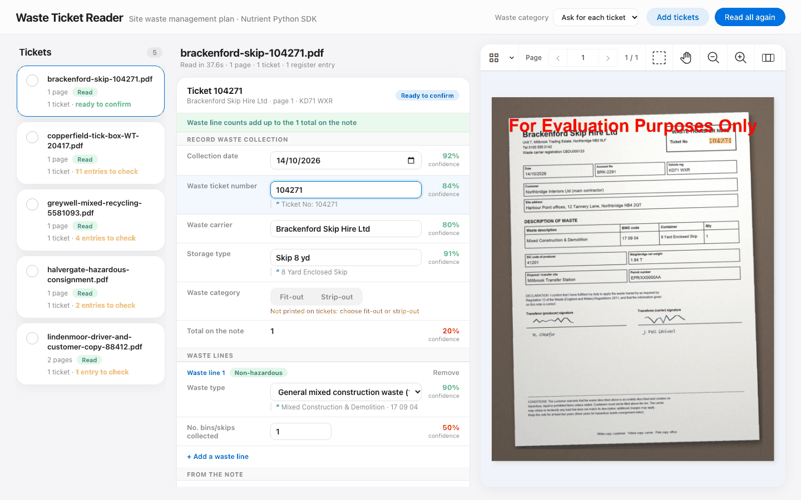
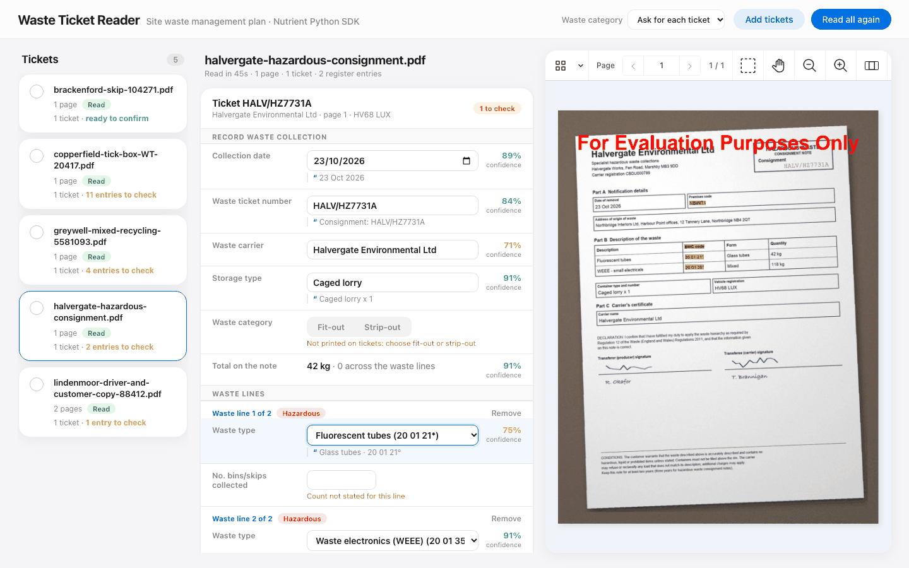

# Nutrient Waste Ticket Extraction

A Nutrient.io demo that reads photos and scans of waste transfer notes and hazardous waste consignment notes, and turns them into pre-filled, reviewable entries for a construction site waste register, with every value highlighted where it was read on the ticket.



1. **Read.** The Nutrient Python SDK runs its ICR engine on the ticket pages (photos or scans, printed or handwritten). Its structured extraction sends the recognized content and a JSON schema to an LLM and returns every distinct note in the document: ticket number, collection date, carrier, licence, site, container, quantity, vehicle and one line per waste type. Each value comes with the SDK's confidence score and the bounding boxes of its source on the page.
2. **Handwriting pass.** When the text reading leaves key fields of a note empty (handwritten or poorly scanned notes), the SDK renders the page and a vision model reads it through the SDK's image description API. On a pre-printed tick-box table every row comes back with its QTY and Tick cells, and the collected rows are chosen by rule: a tick says the waste is there, the QTY says how many, a tick without a number is one container. Values read this way are always flagged to check.
3. **Normalize.** Deterministic rules map the EWC code to a waste type of the list, fuzzy-match the carrier to the carrier list, parse dates, containers and counts, and compare the line counts with the total printed on the note. A note printed twice (driver and customer copy) is read once. A date in the future or older than the retention period is flagged as a likely misread year.
4. **Review.** Each ticket opens as an editable waste collection form. Values under the confidence threshold, or that failed a rule, are flagged with the reason. Clicking a value highlights it on the ticket in the Nutrient Web SDK viewer.
5. **Confirm and archive.** The confirmed ticket becomes one register entry per waste line, with its retention date (2 years, 3 for hazardous waste). The ticket's own pages are saved as a new PDF by the SDK, with the confirmed record embedded in the PDF document information (`WasteCollectionRecord`), so the scan and its data travel together. What the reader proposed and what the reviewer saved is kept with the record as feedback.

The app is a FastAPI backend and a static front end, packaged as one container for Azure Container Apps or any container host.

## Prerequisites

- Python 3.12 or later
- macOS on Apple Silicon or Linux x86_64 (the Nutrient Python SDK native runtimes)
- About 1 GB of disk space for the ICR models. The SDK downloads them on the first run.
- An LLM: an OpenAI or Anthropic API key, an OpenAI-compatible endpoint (for example an Azure-hosted deployment), or Ollama with a local model such as `qwen2.5:7b-instruct` (and a vision model such as `qwen2.5vl:7b` for handwriting)
- Optional: Docker

## Environment variables

Copy `.env.example` to `.env` and fill in what you need. Keys are only read from environment variables, never from code.

| Variable | Purpose | Default |
|---|---|---|
| `NUTRIENT_LICENSE_KEY` | Nutrient Python SDK license key | empty = evaluation mode |
| `NUTRIENT_WEB_SDK_LICENSE_KEY` | Nutrient Web SDK license key, served to the browser by `GET /api/config` | empty = evaluation mode |
| `AI_PROVIDER` | `openai`, `anthropic`, `local` (any OpenAI-compatible endpoint) or `ollama` | `openai` |
| `AI_API_KEY` | API key of the provider. Not needed for `ollama` | empty |
| `AI_MODEL` | Model of the text pass | `gpt-4o`, `qwen2.5:7b-instruct` with `ollama` |
| `AI_ENDPOINT` | Custom endpoint, for `local` | empty |
| `IMAGE_MODEL` | Vision model of the handwriting pass | `AI_MODEL` |
| `OLLAMA_URL` | Ollama server, for `ollama` | `http://127.0.0.1:11434` |
| `OLLAMA_MAX_TOKENS`, `OLLAMA_PRESENCE_PENALTY` | Answer length cap and presence penalty added to Ollama requests. A small model can otherwise loop inside a JSON array until the context limit | `2000`, `0.6` |
| `VISION_ENGINE` | `icr` (local ICR), or `vlm` (VLM-enhanced ICR: the page images are also read by the AI model) | `icr` |
| `VISION_FEATURES` | SDK vision features, comma separated (`TABLE`, `FORM`, `KEY_VALUE_REGION`, `HANDWRITING`...). `TABLE` keeps per-row waste tables intact | `TABLE` |
| `LAYOUT_CONFIDENCE` | Threshold of the SDK page-layout model. The SDK default (0.5) drops answer cells on form-style notes | `0.2` |
| `IMAGE_PASS` | `0` turns the handwriting pass off | `1` |
| `IMAGE_WORKERS` | Pages read as images in parallel | `4` |
| `VLM_FAST_MODE` | The SDK fast mode for reasoning models | `1` |
| `REVIEW_BELOW` | Values under this confidence (%) are flagged to check | `70` |
| `PORT` | Server port | `8080` |
| `INPUT_DIR`, `OUTPUT_DIR` | Tickets folder, and folder of readings, records and archives | `inputs/`, `outputs/` |

With `AI_PROVIDER=ollama`, the SDK calls Ollama through a relay in the app (`/internal/ollama`, reachable from the machine only). The relay removes the token log-probability request, which Ollama cannot answer in the form the SDK expects; the confidence score is then the SDK's grounding score. Nothing leaves the machine.

In evaluation mode the Python SDK hides part of the recognized text ("This content is hidden in trial mode"), so readings are incomplete, and the viewer shows a watermark. Ask Nutrient for an evaluation license key to see complete readings.

## Build and run

```bash
cp .env.example .env
```

```bash
./run.sh
```

Open <http://localhost:8080>.

`run.sh` creates `.venv`, installs `backend/requirements.txt` on the first run, loads `.env` and starts uvicorn. The viewer loads the Nutrient Web SDK 1.6.0 from `https://cdn.cloud.pspdfkit.com/pspdfkit-web@1.6.0/`.

### With Docker (Azure Container Apps)

```bash
docker build -t nutrient-waste-ticket-extraction .
```

```bash
docker run --rm -p 8080:8080 --env-file .env nutrient-waste-ticket-extraction
```

On Azure, push the image to your registry and create a Container App with the same environment variables, the keys as secrets. Mount a volume (Azure Files) on `/app/outputs` to keep the confirmed records and archives.

## Using the app

1. **Read.** Press **Read all tickets**, or tick the circles of a selection first. **Add tickets** uploads more PDFs. The progress bar shows the step of each ticket.
2. **Check.** Select a ticket. Each note it holds opens as a waste collection form. Flagged values say why: low confidence, read from handwriting, carrier or waste type not matched with certainty, unusual date, counts not adding up. The quote under each value is what was printed on the ticket.
3. **Locate.** Click a value. It is highlighted on the ticket when its position is exact, and outlined when it is the approximate position of handwriting read from the page image.

   

4. **Decide.** Fit-out or strip-out is not printed on tickets: pick the waste category per ticket, or pre-select it in the top bar for a batch. Correct any value, add or remove waste lines.
5. **Confirm.** **Confirm & send to register** stores one entry per waste line and archives the ticket pages as a PDF with the record embedded. **Register entries** downloads all confirmed entries as JSON.

The screenshots were taken with a Nutrient Python SDK license key and the local model `qwen2.5:7b-instruct` through Ollama. A small local model makes more reading mistakes than a large hosted model: the review step is there for that. With these local models the handwritten tick-box sample is not read correctly (every printed row comes back, all flagged to check); the handwriting pass needs a strong vision model.

## API

| Method and path | Description |
|---|---|
| `GET /api/files` | The tickets in `INPUT_DIR`, with page count, cached reading and confirmed tickets |
| `POST /api/upload?name=x.pdf` | Raw PDF body. Adds a ticket, the call a host application makes when a ticket is attached to a collection |
| `POST /api/process?file=x.pdf` | Reads a ticket. Returns the notes, their fields with confidence and boxes, and the proposed entries |
| `GET /api/result?file=x.pdf` | The last reading of a ticket |
| `GET /api/progress?job=...` | Progress of a reading started with `&job=...` |
| `POST /api/confirm` | JSON: the reviewed ticket. Returns the record: entries, retention, link to the archived PDF |
| `GET /api/records` | All confirmed records |
| `DELETE /api/records?id=...` | Reopens a confirmed ticket |
| `GET /api/archive?id=...` | The archived ticket PDF. With `&data=true`, the record read back from that PDF |
| `GET /api/reference` | Waste types, carriers, storage types, waste categories, retention periods |
| `GET /api/config` | `{ web_sdk_license_key }` |

## Reference data

`backend/reference/waste_types.json` lists the waste types of the register with their EWC code (European Waste Catalogue) and category (controlled or hazardous). A ticket's EWC code is matched exactly; a code missing from the list gets the nearest type suggested and is flagged. `backend/reference/carriers.json` lists the waste carriers and their aliases; names read on tickets are fuzzy-matched against it. Replace both files with the lists of your own register.

## Samples

`inputs/` holds five fictitious tickets, each a phone photo of a paper note (slightly rotated and keystoned, uneven light, noise): a skip exchange, a note with four materials in bin-size columns, a hazardous waste consignment note, a handwritten tick-box note and a note scanned twice (driver and customer copy). Every company, site, person, number and registration on them is invented. To regenerate them:

```bash
pip install -r samples/requirements.txt
```

```bash
python samples/generate_tickets.py
```

## Layout

| Path | Role |
|---|---|
| `backend/app.py` | FastAPI: reading, progress, review, archive and reference endpoints, Ollama relay, static front end |
| `backend/ticket_schema.py` | The extraction schema and instructions |
| `backend/extraction.py` | SDK structured extraction, handwriting pass, merge into tickets and entries |
| `backend/normalize.py` | EWC and waste type matching, carrier matching, dates, containers, counts, retention |
| `backend/records.py` | Confirmed records and archived ticket PDFs with the record embedded |
| `backend/reference/` | Waste types and carriers |
| `frontend/` | Reader UI: ticket list, editable form, Web SDK viewer with highlights |
| `inputs/` | Sample tickets |
| `samples/` | Sample generator |
